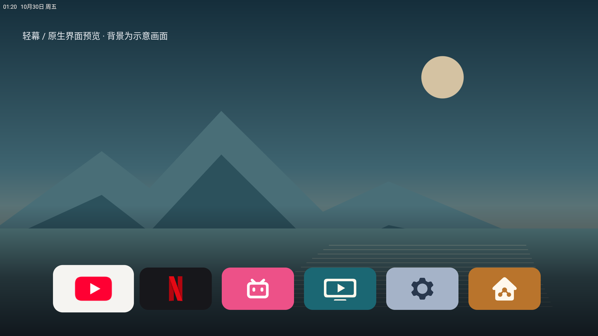
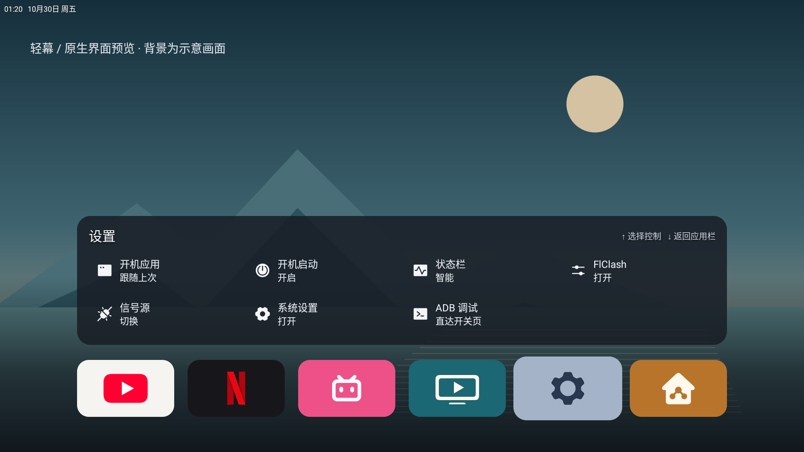
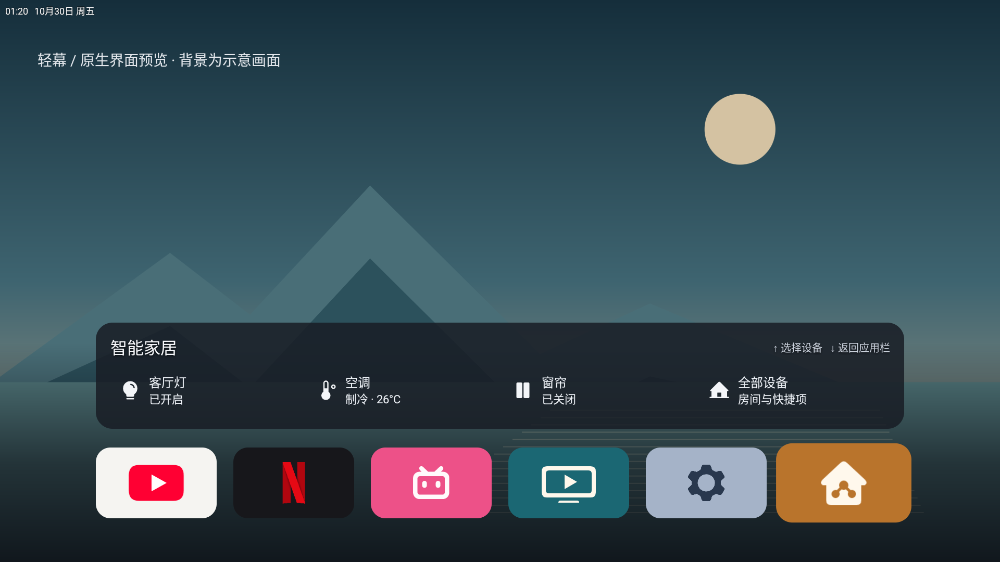

# Lightframe TV

[中文](README.md) · [v0.2.1 downloads](https://github.com/techfanseric/lightframe-tv/releases/tag/v0.2.1)

A transparent Android TV HOME relay and native overlay. Press Home to switch applications above the current video; startup can follow the last application. Content autoplay depends on the video client.



The images are native emulator renders with an illustrative background and fictional home labels, not captures of television playback.

| Settings | Smart home |
| --- | --- |
|  |  |

Version 0.2 adds small themed cards, 12% focus scaling, a bottom gradient, adaptive compact panels, Phosphor Fill content icons, a transparent clock, and an ADB settings-page shortcut. Expanding a panel does not move the dock.

## Requirements and limits

Android 9/API 28+, working ADB, overlay and usage-access permissions. Tested on one ARM32 Android 9 Xiaomi TV. Other Android TV/Google TV firmware needs validation; Tizen and webOS cannot install these APKs.

YouTube/Netflix preflight currently requires configured FlClash VPN, its authenticated local controller at port 9090, and a valid connection. There is no direct-network mode. Subscriptions, VPN authorization, media accounts and Home Assistant credentials are not included. Netflix DRM/certification and Google-service compatibility remain device-dependent. The optional playback guardian targets a specific confirmed failure pattern; never disable Google services as a generic installation step.

## Install

Extract `Lightframe-v0.2.1-setup.zip`, install Python 3.9+ and Android Platform Tools, enable ADB on the TV, then:

```sh
adb connect TV_IP:5555
python3 scripts/setup.py doctor --serial TV_IP:5555 --bundle .
python3 scripts/setup.py install --serial TV_IP:5555 --bundle .
# Configure the VPN/controller and applications before activation.
python3 scripts/setup.py activate --serial TV_IP:5555 --bundle .
```

Use `py -3` on Windows. Modern wireless debugging may require `adb pair` and a different port. Optional companions are distributed separately in the same Release; existing third-party apps are skipped. The installer does not clear application data, uninstall apps or reboot the TV.

See the detailed [installation guide](docs/install.md), [integrations](docs/integrations.md), [Home Assistant](docs/home-assistant.md), [compatibility](docs/compatibility.md), [troubleshooting](docs/troubleshooting.md), [build guide](docs/build-release.md) and [third-party notices](docs/third-party.md). Guides are currently in Chinese; commands and package identities are explicit.

The new package pair uses `.dock` IDs. Activating it disables the original Lightframe pair while retaining its data; the recorded previous HOME and package state can be restored. Old encrypted credentials require reconfiguration. Both status strips share one visibility preference. No live blur or screen capture is performed.
