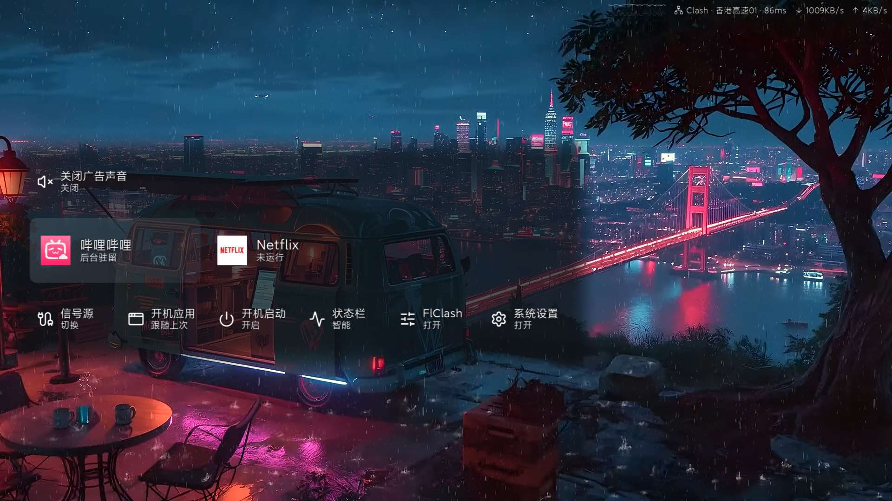

# 轻幕 · Lightframe TV

[English](README.en.md)

**无首页，开机直达你想看的 App。**

[下载最新 Release](https://github.com/techfanseric/lightframe-tv/releases/latest)

轻幕不提供单独的桌面首页。开机后直接进入视频 App；观看时按首页键，只唤出覆盖在当前画面上的轻量切换菜单，选好应用即可直接切换。



电视实机：视频继续显示，首页键唤出应用切换菜单和常用设置。

## 核心特点

- **无独立首页**：无需先回桌面再找应用，电视始终围绕你正在使用的 App。
- **开机直达指定 App**：可选择 YouTube、哔哩哔哩或 Netflix，也可跟随上次使用的应用；默认跟随上次，自动打开可单独关闭。
- **视频中直接切换**：首页键唤出应用切换菜单，隐藏当前 App、按最近使用排序，默认选中上一个 App；左右键循环，上下切行。
- **自动检测和启动代理**：检测已配置的 FlClash VPN 状态，未连接时尝试启动代理；打开 YouTube / Netflix 前检查控制器与目标网络是否就绪，避免开机网络尚未连通时直接卡在应用中。无需代理的 B 站直接打开。
- **网络状态一眼可见**：顶部小状态栏动态显示代理节点、延迟、上传/下载速率及流量曲线，不占用一整块画面。
- **状态栏智能显示**：默认在 B 站前台自动隐藏，离开后恢复；也可选择常开或常关，并记住选择。
- **常用设置直接可达**：信号源、开机应用、开机启动、状态栏、FlClash 和系统设置横向列出，图标在左、文字在右。
- **克制的视觉层次**：左侧居中的连续半透明衬底，仅焦点项有底色，减少贴片和边框干扰。
- **可选广告声音开关**：仅在 YouTube 菜单上方显示“关闭广告声音”，默认关闭，初始焦点仍在应用行。通过外部助手控制广告声音，和自动跳过相互独立。
- **原生信号源集成**：针对已验证的小米固件，支持信号源选择和 HDMI 接入自动切换。

代理自动启动依赖事先配置好的 FlClash、订阅和系统 VPN 授权；轻幕不会代为提供代理线路。视频应用和会员账号也需另行安装、登录。

## 下载与安装

从 [Release](https://github.com/techfanseric/lightframe-tv/releases/latest) 下载 **LightframeHome.apk** 和 **LightframeOverlay.apk**，两者需配套安装：前者接管首页键，后者提供切换菜单和状态栏。安装命令见下方；直接使用 Release APK 不需要 Android SDK 构建环境。

## 遥控器

| 按键 | 行为 |
| --- | --- |
| 首页 | 唤出 / 收起菜单 |
| 左右 | 当前行循环切换 |
| 上下 | 在应用、设置与 YouTube 专属行之间移动 |
| 确认 | 打开应用或执行当前选项 |
| 返回 | 收起菜单 |
| 菜单 | 聚焦设置行 |

## 构建

需要 JDK 17、Android SDK Platform 35、Build Tools 35.0.0、Python 3 和 `zip`。

```sh
export JAVA_HOME=/path/to/jdk-17
export ANDROID_SDK_ROOT=/path/to/android-sdk
./scripts/build.sh
```

输出为 `dist/LightframeHome.apk` 和 `dist/LightframeOverlay.apk`。也可通过 `LIGHTFRAME_BUILD_TOOLS`、`LIGHTFRAME_ANDROID_JAR` 指定现有工具路径。

两个 APK 必须使用同一签名。构建脚本会为新 checkout 在 `.local/signing.jks` 创建开发密钥；更新已安装版本须沿用原密钥。可用 `LIGHTFRAME_KEYSTORE`、`LIGHTFRAME_KEY_ALIAS`、`LIGHTFRAME_STORE_PASSWORD`、`LIGHTFRAME_KEY_PASSWORD` 指定签名。私钥和构建产物不进入 Git。

## 安装

目标电视须开启 ADB，且支持允许悬浮窗和使用情况访问。请先构建，再设置设备序列号：

```sh
export TV_ADB_SERIAL=your-tv-ip:5555
./scripts/install.sh "$TV_ADB_SERIAL" --set-home
```

`--set-home` 将此应用设为默认桌面；不传则只安装和授权。脚本不重启、不清数据，也不禁用原桌面。安装完成后，准备好时用遥控器按首页键。

已有 App、FlClash VPN、订阅和会员登录需另行配置，本仓库不分发这些内容。Clash 控制器接入及广告声音开关见 [集成配置](docs/integrations.md)。

## 结构与兼容性

- `apps/home`：透明 HOME 转接入口、启动与原生系统功能桥接。
- `apps/overlay`：独立悬浮服务、菜单、状态栏、使用记录及网络门控。
- `scripts`：共用构建、安装和本地凭据配置。

两包用签名权限通信，保留 `local.simple.tvhome` / `local.simple.tvoverlay` 包名以兼容已有安装与偏好。已验证设备为 Android 9 / API 28、ARM32 小米电视（alita / MiTV-MFTP0）；其他固件的输入源、原生设置和按键行为需实机验证。

当前背景是局部渐隐衬底，不是跨应用实时毛玻璃。它不会采集屏幕或逐帧做图像滤镜。原生语音入口可唤起，但遥控器语音识别仍依赖设备原有服务，尚未解决其识别故障。第三方视频 App 的认证、DRM 与实际播放兼容性不由启动器保证。

## 第三方资源

图标使用 [Lucide](https://lucide.dev/)，ISC 许可随 SVG、来源清单和 APK 资源保留在 `apps/overlay/third-party/lucide/`。应用图标在运行时读取已安装应用。
